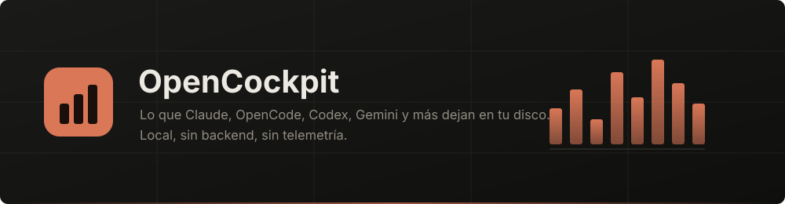

<p align="center">
  
</p>

<p align="center">
  
  
  
  
  
</p>

<p align="center">
  <a href="README.md">Español</a> · <b>English</b>
</p>

---

**OpenCockpit** is a local-first desktop dashboard for the files AI coding tools
leave on your disk: sessions, tokens, costs, conversations, memories, MCP
servers, hooks and skills.

It started as **Claude Cockpit** (Claude Code only). OpenCockpit keeps the same
panel and adds six more tools:

| Tool | What it reads | Usage / tokens | Cost | Conversations |
|---|---|---|---|---|
| **Claude Code** | `~/.claude` (JSONL transcripts, usage, config) | Yes | Estimated at public API rates | Yes |
| **OpenCode** | `~/.local/share/opencode/opencode.db` (SQLite) | Yes | Real, as recorded by OpenCode | Yes |
| **Codex** | `~/.codex/sessions/**/*.jsonl` + `state_5.sqlite` | Yes | Not recorded | Yes |
| **Gemini / Antigravity** | `~/.gemini/antigravity/conversation_summaries.db` | No | No | Session metadata only (protobuf) |
| **GitHub Copilot** | `%APPDATA%/Code/**/github.copilot-chat/session-store.db` | No | No | Yes |
| **Cursor** | `%APPDATA%/Cursor/User/globalStorage/state.vscdb` | When Cursor stores it | No | Yes |
| **Cline / Roo Code** | `%APPDATA%/Code/**/saoudrizwan.claude-dev/tasks/` | Yes | Real, as recorded by the extension | Yes |

The provider filter in the header scopes the whole panel (Overview, Tokens and
Conversations) to one tool or all of them. Each tool has its own accent color:
orange for Claude, green for Codex, blue/violet for Gemini, and so on.

## Install

Download the installer from
[Releases](https://github.com/lucabaello1998/OpenCockpit/releases/latest) and run
it. No Node, no commands.

> Windows will show a SmartScreen warning: the installer is not code-signed
> (certificates cost money). *More info → Run anyway*, or build it yourself.

## Run from source

```bash
npm install
npm start          # build and open the app
```

| Command | What it does |
|---|---|
| `npm run dev` | Vite + Electron with hot reload |
| `npm start` | build and open the app |
| `npm run dist` | NSIS installer in `release/` |
| `npm run audit` | security and correctness checks |
| `npm run icon` | regenerate `build/icon.ico` |

Requires **Node 20+**. Tested on Windows. Packaging currently produces a
Windows installer only.

## First run

OpenCockpit does not sign you in to any tool. It reads what is already on disk.
If it cannot find data from any tool, it tells you exactly what is missing. If
you only have OpenCode, Codex or Gemini, it still opens and shows what it can.

The first-run notice lists **every file it reads**. Nothing leaves your machine
except through two explicit actions: *Refresh usage* (reads Claude limits with
your OAuth session) and *Fetch current prices* (reads the public pricing table).

## What you get

- **Overview**: sessions, requests, tokens, cost, projects, models, most-used
  tools, Claude limit meters, and a **Sources** card showing what each provider
  contributes.
- **Tokens & cost**: series by period, cache, subagents and a per-session table.
  If a source does not record cost (Codex/Gemini) or the model is free, it falls
  back to tokens instead of showing everything as $0.
- **Conversations**: list and full thread for Claude, OpenCode, Codex, Copilot,
  Cursor and Cline/Roo. For Gemini/Antigravity it lists the session with date and
  project, and explains that the transcript is protobuf-encoded.
- **Memories, Boards, Settings, Daily review**: Claude Code panels (MCP, hooks,
  skills, workflows, memory and limits). They keep working the same way and the
  UI makes clear when the provider filter is set to another tool.

## Why the numbers are right

- Claude: requests are deduplicated by `message.id` + `requestId` across parent
  and subagent transcripts; subagents are added to the root session.
- OpenCode: request detail comes from `session_message.data.tokens`; child
  sessions are added to the root.
- Codex: `token_count` is cumulative; the app stores the delta between events
  and separates cached tokens from input.
- Without a pricing table the app does not draw dollars: it shows exact tokens.

## How it is built

- Electron 44 + Vite + React 19.
- `src/main/sources/providers/` has one adapter per tool (`opencode.cjs`,
  `codex.cjs`, `gemini.cjs`, `copilot.cjs`, `cursor.cjs`, `cline.cjs`). All
  return the same normalized session/request shape, so the rest of the app does
  not need to know where the data came from.
- `src/main/store.cjs` builds a snapshot per provider and caches it until the
  next refresh.
- Path containment lives in `src/main/safePaths.cjs`; every write coming from
  the renderer or an imported package goes through it.

## Security

```bash
npm run audit
```

The checks cover the sensitive surfaces: paths confined to each tool's folders,
validated IPC, configuration writes only after confirmation and backup, and
sanitization of rendered content. The app has no server and no telemetry.

## Publishing a release

1. Bump `version` in `package.json`.
2. `npm run dist` produces the installer, its `.blockmap` and `latest.yml` in
   `release/`.
3. Publish those files in the `lucabaello1998/OpenCockpit` GitHub release. The
   auto-updater looks for them there.

The updater **never installs anything on its own**: it tells you, shows the
release notes, and you choose when to download and when to restart.

## License

MIT. See [LICENSE](LICENSE).

---

<p align="center">
  <sub>Built to understand where my time and money were going with AI coding tools.</sub>
</p>
