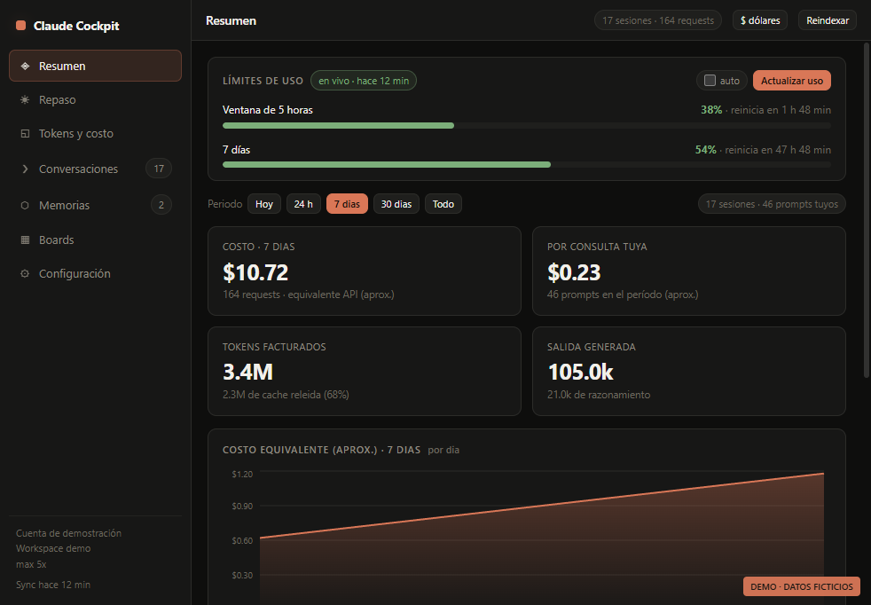
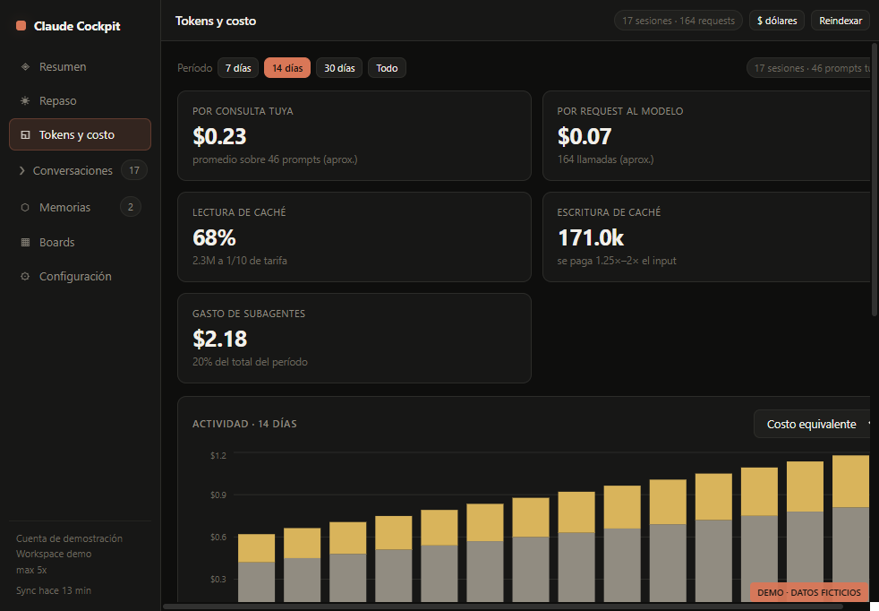
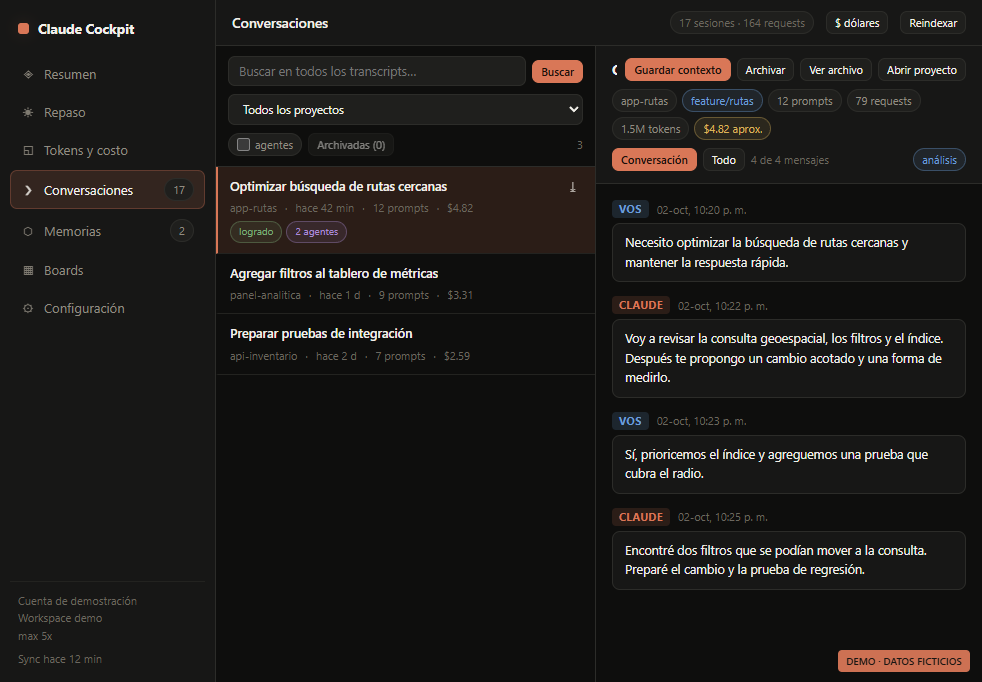

<p align="center">
  
</p>

<p align="center">
  
  
  
  
  
</p>

# OpenCockpit

Dashboard de escritorio para mirar lo que las herramientas de IA dejan en tu
disco: sesiones, tokens, costos, conversaciones, memorias, MCP, hooks y skills.

Nació como **Claude Cockpit** (solo Claude Code) y esta versión suma otras
herramientas con el mismo panel:

| Herramienta | Qué se lee | Uso/tokens | Costo | Conversaciones |
|---|---|---|---|---|
| **Claude Code** | `~/.claude` (transcripts JSONL, usage, config) | Sí | Estimado con tarifa API | Sí |
| **OpenCode** | `~/.local/share/opencode/opencode.db` (SQLite) | Sí | Real, el que registra OpenCode | Sí |
| **Codex** | `~/.codex/sessions/**/*.jsonl` + `state_5.sqlite` | Sí | No lo registra | Sí |
| **Gemini / Antigravity** | `~/.gemini/antigravity/conversation_summaries.db` | No | No | No (protobuf) |
| **GitHub Copilot** | `%APPDATA%/Code/…/github.copilot-chat/session-store.db` | No | No | Sí |
| **Cursor** | `%APPDATA%/Cursor/User/globalStorage/state.vscdb` | Si Cursor lo guardó | No | Sí |
| **Cline / Roo Code** | `%APPDATA%/Code/…/saoudrizwan.claude-dev/tasks/` | Sí | Real, el que registra la extensión | Sí |

El **filtro de proveedor** del encabezado acota todo el panel (Resumen, Tokens y
Conversaciones) a una sola herramienta o suma todas. Cada herramienta tiene su
paleta: al elegirla, el acento y el degradado animado del fondo cambian de color
(naranja para Claude, azul/violeta para Gemini, verde para Codex, etc.).



## Capturas

| Tokens y costo | Conversaciones |
|---|---|
|  |  |

## Por qué existe

- **Un solo lugar.** Si usás Claude Code para una cosa, OpenCode para otra y Codex
  para un experimento, tener tres números distintos no te dice nada. Acá se suman
  (o se separan con el filtro de proveedor).
- **Historial completo, no el último día.** Lo que cada herramienta deja en disco
  se lee y se agrega: sesiones viejas, subagentes y conversaciones siguen ahí.
- **Sin backend.** No hay servidor, no hay cuenta, no hay telemetría: la app lee
  archivos locales y no manda nada, salvo las dos acciones que pedís a mano
  (actualizar límites de Claude y buscar precios).
- **Números que cierran.** Deduplicación por `message.id`/`requestId`, subagentes
  sumados a la sesión raíz y deltas para los `token_count` acumulativos.

Lo que **no** hace: no te loguea en ninguna herramienta, no reemplaza sus CLIs y
no inventa costos cuando la fuente no los registra (muestra tokens en su lugar).

## Instalar

Bajá el instalador desde
[Releases](https://github.com/lucabaello1998/OpenCockpit/releases/latest) y
ejecutalo. No hace falta Node ni correr nada.

> Windows muestra un aviso de SmartScreen: el instalador no está firmado
> (el certificado es pago). *Más información → Ejecutar de todas formas*, o
> compilalo vos con los pasos de abajo.

## Correr desde el código

```bash
npm install
npm start          # build + abrir la app
```

| Comando | Qué hace |
|---|---|
| `npm run dev` | Vite + Electron con hot reload |
| `npm start` | build y abre la app |
| `npm run dist` | instalador NSIS en `release/` |
| `npm run audit` | la suite de seguridad y correctitud |
| `npm run icon` | regenera `build/icon.ico` |

## La primera vez

La app no te loguea en ninguna herramienta: lee lo que ya está en el disco. Si
no encuentra datos de ninguna, te dice exactamente qué falta. Si solo tenés
OpenCode, Codex o Gemini, arranca igual y muestra lo que haya.

El aviso de primer uso lista **todos** los archivos que lee. Nada sale de la
máquina salvo dos acciones explícitas: *Actualizar uso* (consulta los límites de
Claude con tu sesión OAuth) y *Buscar precios actualizados* (lee la tabla de
precios pública).

## Qué muestra

- **Resumen**: sesiones, requests, tokens, costo, proyectos, modelos, herramientas
  más usadas, medidores de límite de Claude y una tarjeta **Fuentes** con lo que
  aporta cada proveedor.
- **Tokens y costo**: series por período, caché, subagentes y tabla por sesión.
  Si la fuente no registra costo (Codex/Gemini) o el modelo es gratis, cae a
  tokens en vez de mostrar todo en $0.
- **Conversaciones**: lista e hilo completo de Claude, OpenCode, Codex,
  Copilot, Cursor y Cline/Roo. En Gemini/Antigravity se lista la sesión con su
  fecha y proyecto, y se avisa que la transcripción no es legible sin el esquema
  protobuf.
- **Memorias, Boards, Configuración, Repaso**: paneles de Claude Code (MCP,
  hooks, skills, workflows, memoria y límites). Siguen funcionando igual y se
  aclara cuando el filtro está en otro proveedor.

## Por qué los números dan bien

- Claude: los requests se deduplican por `message.id` + `requestId` entre
  transcripts padre e hijo; los subagentes se suman a la sesión raíz.
- OpenCode: el detalle sale de `session_message.data.tokens`. Las sesiones hijas
  se suman a la raíz.
- Codex: `token_count` es acumulativo; se guarda el delta entre eventos y se
  separan los tokens cacheados del input.
- Sin tabla de precios no se grafican dólares: se muestran tokens exactos.

## Cómo está armado

- Electron 44 + Vite + React 19.
- `src/main/sources/providers/` tiene un adaptador por herramienta
  (`opencode.cjs`, `codex.cjs`, `gemini.cjs`). Todos devuelven la misma forma
  normalizada de sesión y request, así el resto de la app no sabe de dónde
  salieron los datos.
- `src/main/store.cjs` arma un snapshot por proveedor (`all`, `claude`,
  `opencode`, `codex`, `gemini`) y los cachea hasta el próximo refresco.

## Seguridad

```bash
npm run audit
```

La suite cubre las superficies delicadas: rutas confinadas a las carpetas de
cada herramienta, IPC validado, escritura de configuración solo con confirmación
y backup, y sanitización de lo que se muestra. La app no tiene servidor ni
telemetría.

## Publicar una versión

1. Subí `version` en `package.json`.
2. `npm run dist` genera en `release/` el instalador, su `.blockmap` y
   `latest.yml`.
3. Publicá esos archivos en el release de GitHub del repo
   `lucabaello1998/OpenCockpit`. El auto-updater los busca ahí.

## Licencia

MIT. Ver [LICENSE](LICENSE).
